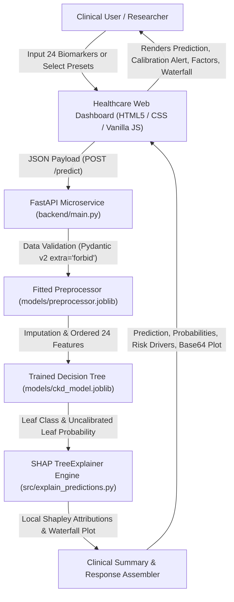

# Explainable AI for Chronic Kidney Disease Prediction using Machine Learning and SHAP

An end-to-end, reproducible Machine Learning and Explainable AI (XAI) clinical decision-support system predicting Chronic Kidney Disease (CKD) risk and delivering transparent, local, and global feature attributions using **SHAP (SHapley Additive exPlanations)**.

---

> [!IMPORTANT]
> **Medical & Academic Disclaimer**:  
> *"This software is an experimental Machine Learning research system developed for academic demonstration and clinical decision-support research. It is NOT a diagnostic tool and does NOT determine clinical CKD stages (Stage 1–5). Model outputs reflect statistical feature attributions and training-sample leaf purity, not calibrated clinical risk or biological causation. It must never replace professional clinical judgment, laboratory testing, or formal diagnosis by a certified medical practitioner."*

---

## 1. Problem Statement

**Chronic Kidney Disease (CKD)** is a progressive loss of renal function characterized by gradual decline in Glomerular Filtration Rate (GFR). It represents a critical global healthcare challenge:
- **Asymptomatic Early Progression**: In its initial stages (Stages 1–3), CKD rarely exhibits overt outward symptoms. Patients frequently present only after irreversible parenchymal damage has occurred, requiring dialysis or transplantation.
- **Biomarker Synthesis Challenge**: Early nephrology diagnosis relies on subtle multivariate interactions across blood chemistry (creatinine, blood urea), electrolyte balance (sodium, potassium), urinalysis (specific gravity, albuminuria), and comorbidities (hypertension, diabetes mellitus).
- **The "Black-Box" Dilemma in Healthcare AI**: While machine learning models can detect non-linear diagnostic patterns, high predictive accuracy alone is insufficient for clinical adoption. Clinicians, regulatory bodies, and patients cannot ethically or legally trust opaque predictions without interpretable, patient-specific explanations.
- **Data Contamination in Literature**: Many published healthcare models suffer from subtle data leakage (fitting imputation statistics on entire datasets before splitting), resulting in overly optimistic results that fail in practical deployment.

---

## 2. Objectives

1. **Leak-Free Data Preprocessing**: Develop a robust scikit-learn compatible preprocessing pipeline where all imputation statistics (median for skewed continuous variables, mode for discrete categoricals) and binary encodings are fitted strictly on the training partition ($N=320$) and applied without modification to test and inference data.
2. **Interpretable Model Training**: Train an inherently interpretable Decision Tree Classifier configured with balanced class weighting (`class_weight='balanced'`) and depth constraints (`max_depth=5`) to maximize clinical sensitivity for early disease detection while preventing overfitting.
3. **Empirical Evaluation & Benchmarking**: Evaluate performance rigorously on a strictly held-out test cohort ($N=80$) across accuracy, precision, recall (sensitivity), specificity, F1-score, confusion matrix, ROC-AUC, and 5-fold cross-validation, benchmarking against Dummy, Logistic Regression, and Random Forest baselines.
4. **Game-Theoretic XAI with SHAP**: Integrate `shap.TreeExplainer` to compute exact, polynomial-time Shapley attributions in probability space, providing cohort-level global rankings and patient-level waterfall plots satisfying the mathematical additivity property ($E[f(x)] + \sum \phi_i = f(x)$).
5. **Production Microservice Architecture**: Develop an asynchronous FastAPI backend with strict Pydantic v2 data validation, physiological bounds checking, and field-specific error isolation.
6. **Accessible Healthcare Dashboard**: Build a responsive, zero-dependency HTML5/Vanilla CSS/JavaScript dashboard featuring one-click clinical presets, probability calibration disclosures, and dynamic XAI visualizations.
7. **Production Containerization & Deployment**: Containerize the complete application using Docker and provide deployment configuration for cloud hosting platforms (Render, Railway, Hugging Face Spaces) with complete environment portability.

---

## 3. System Architecture



### Architectural Highlights
- **Stateless Inference**: Zero patient data is written to disk or database; all payload computations execute entirely in volatile application memory.
- **Singleton Lifecycle Cache**: The model, preprocessor, and TreeExplainer are loaded once into memory during FastAPI lifespan startup, guaranteeing sub-50ms inference times.
- **Fail-Safe Client / Server Validation**: Both client-side JavaScript and backend Pydantic schemas enforce identical physiological limits (e.g., blood pressure 50–200 mmHg, serum creatinine 0.4–20.0 mg/dL).

---

## 4. Technology Stack

| Layer | Technology | Version | Purpose |
| :--- | :--- | :--- | :--- |
| **Language** | Python | 3.10 – 3.14 | Core language for machine learning and microservice |
| **Data Processing** | Pandas, NumPy | $\ge$ 2.2.0, $\ge$ 1.26.0 | Missing value handling, stratified splitting, feature matrices |
| **Machine Learning** | Scikit-learn, Joblib | $\ge$ 1.4.0, $\ge$ 1.3.0 | Decision Tree Classifier, evaluation metrics, artifact serialization |
| **Explainable AI** | SHAP | $\ge$ 0.45.0 | TreeExplainer, exact Shapley values, beeswarm and waterfall plots |
| **Plot Generation** | Matplotlib | $\ge$ 3.8.0 | Publication-quality headless vector rendering (Agg backend) |
| **Backend API** | FastAPI, Uvicorn | $\ge$ 0.110.0, $\ge$ 0.28.0 | High-performance asynchronous REST microservice |
| **Schema Validation** | Pydantic (v2) | $\ge$ 2.6.0 | Strict clinical typing, physiological bounds, `extra="forbid"` |
| **Frontend UI** | HTML5, CSS3, JavaScript | ES6+ | Modern, responsive clinical dashboard with Fetch API (zero external frameworks) |
| **Automated Testing** | Pytest, HTTPX | $\ge$ 8.0.0, $\ge$ 0.27.0 | Automated unit, evaluation, explainability, API, and integration test suite |
| **Containerization** | Docker | 28.5+ | Portable multi-stage POSIX containerization |

---

## 5. Dataset Source and Attribution

- **Dataset Name**: Chronic Kidney Disease (CKD) Dataset
- **Repository**: UCI Machine Learning Repository (Dataset ID: 336)
- **DOI / URL**: [https://doi.org/10.24432/C5G016](https://doi.org/10.24432/C5G016)
- **Clinical Source**: Donated by Dr. P. Soundarapandian, M.D., D.M. (Senior Consultant Nephrologist), P. Anita, and colleagues from Apollo Hospitals, Tamil Nadu, India (2015).
- **Cohort Volume**: 400 patient instances.
- **Target Variable**: `class` (binary: `ckd` vs `notckd`).
- **Class Balance**: 250 CKD cases (62.5%) and 150 Non-CKD cases (37.5%).
- **Feature Dimensionality**: 24 clinical parameters (14 continuous numerical, 10 nominal/categorical):

| Feature Code | Clinical Description | Data Type | Units / Valid Levels |
| :--- | :--- | :--- | :--- |
| `age` | Patient Age | Numerical | 1 – 100 years |
| `bp` | Blood Pressure | Numerical | 50 – 180 mm/Hg |
| `sg` | Urine Specific Gravity | Numerical | 1.005, 1.010, 1.015, 1.020, 1.025 |
| `al` | Albumin in Urine | Numerical | 0, 1, 2, 3, 4, 5 (urinalysis scale) |
| `su` | Sugar in Urine | Numerical | 0, 1, 2, 3, 4, 5 (urinalysis scale) |
| `rbc` | Red Blood Cells in Urine | Categorical | `normal`, `abnormal` |
| `pc` | Pus Cells in Urine | Categorical | `normal`, `abnormal` |
| `pcc` | Pus Cell Clumps | Categorical | `present`, `notpresent` |
| `ba` | Bacteria in Urine | Categorical | `present`, `notpresent` |
| `bgr` | Blood Glucose Random | Numerical | 20 – 500 mg/dL |
| `bu` | Blood Urea | Numerical | 1 – 400 mg/dL |
| `sc` | Serum Creatinine | Numerical | 0.4 – 20.0 mg/dL |
| `sod` | Serum Sodium | Numerical | 100 – 180 mEq/L |
| `pot` | Serum Potassium | Numerical | 2.0 – 10.0 mEq/L |
| `hemo` | Hemoglobin | Numerical | 3.0 – 20.0 g/dL |
| `pcv` | Packed Cell Volume | Numerical | 10 – 60 % |
| `wbcc` | White Blood Cell Count | Numerical | 2,000 – 30,000 cells/cu.mm |
| `rbcc` | Red Blood Cell Count | Numerical | 2.0 – 8.0 millions/cu.mm |
| `htn` | Hypertension | Categorical | `yes`, `no` |
| `dm` | Diabetes Mellitus | Categorical | `yes`, `no` |
| `cad` | Coronary Artery Disease | Categorical | `yes`, `no` |
| `appet` | Appetite | Categorical | `good`, `poor` |
| `pe` | Pedal Edema | Categorical | `yes`, `no` |
| `ane` | Anemia | Categorical | `yes`, `no` |

---

## 6. Dataset Preprocessing

To ensure clinical validity and absolute zero data leakage:
1. **Stratified Partitioning**: The 400 patient records were partitioned into 80% training ($N=320$) and 20% held-out test ($N=80$) splits using `stratify=y` with `random_state=42`.
2. **Leak-Free Median Imputation**: Continuous variables exhibit significant clinical skewness due to severe pathology (e.g., serum creatinine up to 15.0+ mg/dL). Medians computed strictly on `X_train` are used to impute missing continuous entries.
3. **Leak-Free Mode Imputation**: Categorical variables are imputed using modal categories derived strictly from `X_train`.
4. **Binary Encoding**: Categorical labels are converted to numerical indicators ($0 = \text{normal/absent/good/no}$, $1 = \text{abnormal/present/poor/yes}$).
5. **Feature Schema Serialization**: Imputation medians, modes, and column orders are saved in `models/preprocessor.joblib` and `data/processed/preprocessing_metadata.json`, ensuring the exact same transformations execute during inference.

---

## 7. Machine Learning Algorithm

A **Decision Tree Classifier** (`DecisionTreeClassifier`) was chosen as the core predictive estimator:
- **Clinical Interpretability**: Decision trees mirror clinical decision logic (threshold-based rule paths), allowing direct human review of split criteria.
- **Exact Polynomial TreeSHAP**: Decision trees are natively supported by `shap.TreeExplainer`, which computes exact Shapley values in $O(TLD^2)$ time without heuristic sampling approximations.
- **Fast, Deterministic Inference**: Eliminates deep learning compute overhead and executes inference in under 5 milliseconds.

### Hyperparameters Configured
```python
DecisionTreeClassifier(
    criterion='gini',
    max_depth=5,              # Prevents deep uninterpretable rule chains
    min_samples_split=4,      # Ensures split robustness
    min_samples_leaf=2,       # Prevents single-instance outlier leaves
    class_weight='balanced',  # Weights minority classes inversely to penalize False Negatives
    random_state=42           # Guarantees deterministic reproducibility
)
```

---

## 8. Model Evaluation Results

### 8.1 Performance on Held-Out Test Set ($N=80$)

| Evaluation Metric | Value | Clinical Meaning |
| :--- | :---: | :--- |
| **Accuracy** | **96.25%** | 77 of 80 held-out patient cases correctly classified |
| **Precision (PPV)** | **100.00%** | Zero false alarms ($FP=0$); every patient predicted with CKD actually had CKD |
| **Sensitivity / Recall** | **94.00%** | 47 of 50 CKD patients detected ($FN=3$); high sensitivity for early detection |
| **Specificity (TNR)** | **100.00%** | 30 of 30 healthy patients correctly ruled out |
| **F1-Score** | **0.9691** | Balanced harmonic mean of precision and recall |
| **ROC-AUC Score** | **0.9890** | Outstanding discriminatory capability across probability thresholds |

### 8.2 Confusion Matrix Breakdown ($N=80$)
$$\begin{pmatrix} TN = 30 & FP = 0 \\ FN = 3 & TP = 47 \end{pmatrix}$$

### 8.3 5-Fold Cross-Validation on Training Data ($N=320$)
- **Fold Accuracies**: `[0.9531, 0.9844, 0.9062, 0.9375, 0.9688]`
- **Mean Accuracy**: `95.00% ± 3.06%`
- **Mean ROC-AUC**: `0.9427 ± 0.0350`

### 8.4 Baseline Model Benchmarking

| Model | Test Accuracy | Precision (CKD) | Recall (CKD) | F1-Score | ROC-AUC |
| :--- | :---: | :---: | :---: | :---: | :---: |
| **Dummy (Most Frequent)** | 62.50% | 62.50% | 100.00% | 0.7692 | 0.5000 |
| **Logistic Regression (Standardized)** | 97.50% | 96.15% | 100.00% | 0.9804 | 0.9980 |
| **Random Forest (100 Trees)** | 98.75% | 98.04% | 100.00% | 0.9901 | 0.9993 |
| **Primary Decision Tree** | **96.25%** | **100.00%** | **94.00%** | **0.9691** | **0.9890** |

---

## 9. SHAP Methodology

**SHAP (SHapley Additive exPlanations)** applies cooperative game theory (Lloyd Shapley, 1953) to machine learning:
$$\phi_i(f, x) = \sum_{S \subseteq F \setminus \{i\}} \frac{|S|!(|F| - |S| - 1)!}{|F|!} \left[ f(S \cup \{i\}) - f(S) \right]$$

### Implementation Details:
1. **TreeExplainer Compatibility**: Utilizes `shap.TreeExplainer(model, feature_perturbation='tree_path_dependent')`, which computes exact Shapley attributions in polynomial time.
2. **Positive Class Attribution**: Attributions are dynamically indexed against Class 1 (CKD probability), ensuring that positive $\phi_i > 0$ strictly represents factors increasing disease risk.
3. **Cohort Baseline ($E[f(x)]$)**: Due to balanced class weighting during training, the cohort baseline is exactly $0.5000$.
4. **Mathematical Additivity Verified**: Every patient explanation satisfies:
   $$f(x) = E[f(x)] + \sum_{i=1}^{24} \phi_i(x)$$
5. **Cohort-Level Top Features**:
   - **Hemoglobin (`hemo`)**: 59.3% Gini importance, mean $|SHAP| = 0.1742$ (Anemia from diminished erythropoietin production).
   - **Specific Gravity (`sg`)**: 20.5% Gini importance, mean $|SHAP| = 0.1085$ (Tubular concentration defect).
   - **Red Blood Cell Count (`rbcc`)**: 9.6% Gini importance, mean $|SHAP| = 0.0412$.
   - **Hypertension (`htn`)**: 5.2% Gini importance, mean $|SHAP| = 0.0398$.

---

## 10. Backend Architecture

The backend is developed with **FastAPI** (`backend/main.py`) following clean architecture principles:
- **Lifespan Singleton Cache**: Machine learning model, preprocessor transformer, and TreeExplainer are loaded during startup and injected into application state.
- **Strict Pydantic v2 Schemas** (`backend/schemas.py`):
  - `PatientInputSchema`: Validates all 24 inputs, rejects unpermitted fields (`extra="forbid"`), and enforces physiological bounds.
  - `PredictionResponseSchema`: Returns structured prediction codes, leaf probabilities, ordered risk drivers, narrative summaries, and base64 plots.
- **Environment Configuration**: Dynamic port and host resolution via `PORT` (default `8000`), `HOST` (default `0.0.0.0`), and `CORS_ORIGINS` (default `*`).
- **REST Endpoints**:
  - `GET /`: Microservice identity and navigation.
  - `GET /health`: Health probe reporting status of model, preprocessor, and explainer.
  - `GET /features`: Returns clinical schema, human-readable labels, units, and ranges.
  - `POST /predict`: Primary inference and XAI attribution workflow.
  - `GET /metrics`: Test set performance metrics and Gini feature rankings.
  - `GET /dashboard`: Directly serves the HTML5 clinical dashboard.

---

## 11. Frontend Features

The frontend (`frontend/`) is an accessible, modern healthcare dashboard built with Vanilla HTML5, CSS3, and JavaScript:
- **Zero Heavy Frameworks**: No React, Angular, or Vue overhead; renders instantaneously with clean DOM scripting.
- **Logical Panel Grouping**: Form inputs are organized into 5 clinical sections:
  1. *Patient Vitals* (Age, Blood Pressure).
  2. *Urinalysis* (Specific Gravity, Albumin, Sugar, RBC/Pus Cells, Clumps, Bacteria).
  3. *Blood Chemistry* (Blood Glucose Random, Blood Urea, Serum Creatinine, Sodium, Potassium).
  4. *Hematology* (Hemoglobin, Packed Cell Volume, WBC Count, RBC Count).
  5. *Comorbidities & Symptoms* (Hypertension, Diabetes, CAD, Appetite, Pedal Edema, Anemia).
- **One-Click Clinical Presets**:
  - **Preset 1 (Confirmed CKD Case)**: Populates authentic held-out test patient UCI #204 ($sc=13.5$, $hemo=8.8$, $sg=1.010$).
  - **Preset 2 (Healthy Non-CKD Case)**: Populates authentic held-out test patient UCI #342 ($sc=0.5$, $hemo=15.0$, $sg=1.025$).
- **Client-Side Real-Time Validation**: Highlights inputs with physiological bounds warnings before payload dispatch.
- **Dynamic XAI Waterfall Rendering**: Displays high-resolution base64 PNG waterfall plots showing feature-level shifts from baseline to final score.
- **Transparent Calibration Disclosures**: Informs the user when probabilities represent pure leaf sample counts rather than calibrated epidemiological risks.

---

## 12. Installation Instructions

### Prerequisites
- Python 3.10, 3.11, 3.12, 3.13, or 3.14.
- Git (optional).

### Setup Steps
```powershell
# 1. Navigate to project root
cd "c:\PROJECT\MINI PROJECT\CKD_Explainable_AI"

# 2. Create and activate a virtual environment
python -m venv .venv
.\.venv\Scripts\Activate.ps1    # On Linux/macOS: source .venv/bin/activate

# 3. Upgrade pip and install dependencies
pip install --upgrade pip
pip install -r requirements.txt
```

---

## 13. Commands to Run the Application Locally

### A. Run Data Preprocessing
Ingests raw data, fits leak-free imputation medians/modes on training split ($N=320$), and saves `preprocessor.joblib`:
```powershell
python src/preprocessing.py
```

### B. Train the Decision Tree Model
Trains the model with balanced weights, runs 5-fold cross-validation, and saves `ckd_model.joblib`:
```powershell
python src/train_model.py
```

### C. Evaluate Model & Benchmark
Generates confusion matrix, ROC curve, baseline comparisons, and updates `models/metrics.json`:
```powershell
python src/evaluate_model.py
```

### D. Generate SHAP Visualizations
Generates global summary bar plot, beeswarm chart, and patient waterfall plots in `reports/figures/`:
```powershell
python src/explain_predictions.py
```

### E. Start the FastAPI Web Server & Healthcare Dashboard
Launch the server with live reload on `http://127.0.0.1:8000`:
```powershell
python -m uvicorn backend.main:app --host 127.0.0.1 --port 8000 --reload
```
- **Web Dashboard:** [http://127.0.0.1:8000/dashboard](http://127.0.0.1:8000/dashboard)
- **Interactive Swagger Docs:** [http://127.0.0.1:8000/docs](http://127.0.0.1:8000/docs)
- **Alternative ReDoc UI:** [http://127.0.0.1:8000/redoc](http://127.0.0.1:8000/redoc)

---

## 14. API Endpoint Descriptions

### 1. `GET /health`
Returns system health, artifact loading states, and feature count.
- **Response**: `{"status": "healthy", "model_loaded": true, "preprocessor_loaded": true, "explainer_ready": true, "algorithm": "DecisionTreeClassifier", "features_count": 24, "version": "1.0.0"}`

### 2. `GET /features`
Returns the expected 24 features with data types, valid clinical ranges, units, and categories.

### 3. `POST /predict`
Evaluates a patient's clinical parameters, returning prediction label, probabilities, risk drivers, narrative, and optional waterfall plot.
- **Sample cURL Request (Held-Out Test Record #204 - CKD)**:
```bash
curl -X POST "http://127.0.0.1:8000/predict" \
     -H "Content-Type: application/json" \
     -d '{
       "age": 65.0, "bp": 90.0, "sg": 1.010, "al": 4.0, "su": 2.0,
       "bgr": 172.0, "bu": 82.0, "sc": 13.5, "sod": 145.0, "pot": 6.3,
       "hemo": 8.8, "pcv": 31.0, "wbcc": 8100.0, "rbcc": 4.8,
       "rbc": "normal", "pc": "normal", "pcc": "notpresent", "ba": "notpresent",
       "htn": "yes", "dm": "yes", "cad": "no", "appet": "good", "pe": "yes", "ane": "yes",
       "include_plot": false
     }'
```
- **Sample JSON Response**:
```json
{
  "prediction_label": "Chronic Kidney Disease (CKD)",
  "prediction_code": 1,
  "probabilities": {
    "ckd_probability": 1.0,
    "non_ckd_probability": 0.0
  },
  "explanation_method": "SHAP (TreeExplainer)",
  "explanation": {
    "base_value": 0.5,
    "patient_model_output": 1.0,
    "top_risk_drivers": [
      {
        "feature": "sg",
        "clinical_label": "Specific Gravity (density)",
        "patient_value": 1.01,
        "shap_value": 0.1651,
        "direction": "Increases Predicted CKD Probability"
      },
      {
        "feature": "htn",
        "clinical_label": "Hypertension",
        "patient_value": "yes",
        "shap_value": 0.1597,
        "direction": "Increases Predicted CKD Probability"
      },
      {
        "feature": "hemo",
        "clinical_label": "Hemoglobin (g/dL)",
        "patient_value": 8.8,
        "shap_value": 0.1515,
        "direction": "Increases Predicted CKD Probability"
      }
    ],
    "top_protective_factors": []
  },
  "clinical_summary": "The model's decision path predicts Chronic Kidney Disease (CKD) with an uncalibrated leaf probability of 100.0%...",
  "medical_disclaimer": "Educational Decision Support: SHAP explanations explain algorithmic reasoning..."
}
```

### 4. `GET /metrics`
Returns evaluation metrics (accuracy, precision, recall, specificity, F1, ROC-AUC) and Gini feature importances.

### 5. `GET /dashboard`
Serves the complete responsive HTML5/CSS/JavaScript web dashboard.

---

## 15. Testing Instructions

The repository includes a comprehensive 42-test automated verification suite across 6 dedicated test modules:
```powershell
python -m pytest tests/ -v
```

### Test Suite Organization:
1. `tests/test_preprocessing.py` (6 tests): Validates raw data integrity, median/mode imputation parameter learning, string sanitation, and train/test stratified splitting.
2. `tests/test_model.py` (5 tests): Checks artifact serialization, model reload, test predictions, and inference pipeline.
3. `tests/test_evaluation.py` (3 tests): Verifies mathematical consistency of accuracy, precision, recall, specificity, and confusion matrix arithmetic.
4. `tests/test_explainability.py` (7 tests): Tests `TreeExplainer` initialization, positive-class alignment, additivity check ($E[f(x)] + \sum \phi_i = f(x)$), and waterfall rendering.
5. `tests/test_api.py` (8 tests): Validates `/health`, `/features`, `/predict`, `/metrics`, `/dashboard`, physiological bounds, categorical rejection, and `extra="forbid"`.
6. `tests/test_integration.py` (13 tests): End-to-end multi-step scenarios including preset loading, static asset serving, schema synchronization, and outlier validation.

---

## 16. Deployment Instructions

### 16.1 Docker Containerization
The project includes a production-ready, multi-stage POSIX Docker configuration ([Dockerfile](file:///c:/PROJECT/MINI%20PROJECT/CKD_Explainable_AI/Dockerfile), [.dockerignore](file:///c:/PROJECT/MINI%20PROJECT/CKD_Explainable_AI/.dockerignore)).

1. **Build the Docker image:**
   ```bash
   docker build -t ckd-explainable-ai .
   ```

2. **Run the container locally:**
   ```bash
   docker run -p 8000:8000 -e PORT=8000 -e CORS_ORIGINS="*" ckd-explainable-ai
   ```

3. **Verify running container health:**
   ```bash
   curl http://localhost:8000/health
   ```

### 16.2 Cloud Platform Deployment (Render, Railway, Hugging Face Spaces)
The repository includes standard production configuration files:
- [Procfile](file:///c:/PROJECT/MINI%20PROJECT/CKD_Explainable_AI/Procfile): `web: uvicorn backend.main:app --host 0.0.0.0 --port $PORT`
- [render.yaml](file:///c:/PROJECT/MINI%20PROJECT/CKD_Explainable_AI/render.yaml): Blueprint defining Python 3.11 environment, health check probe at `/health`, and auto-start commands.

#### Deployment Steps on Render:
1. Push this repository to GitHub or GitLab.
2. In Render, select **New Web Service** and link the repository.
3. Select **Python** runtime (or Docker runtime).
4. Set Build Command: `pip install -r requirements.txt`
5. Set Start Command: `python -m uvicorn backend.main:app --host 0.0.0.0 --port $PORT`
6. Add Health Check Path: `/health`

### 16.3 Environment Variables
| Variable | Default Value | Description |
| :--- | :--- | :--- |
| `PORT` | `8000` | Port on which Uvicorn binds |
| `HOST` | `0.0.0.0` | Host IP binding address |
| `CORS_ORIGINS` | `*` | Comma-separated list of allowed origins (e.g., `https://myhospital.org,http://localhost:3000`) |

---

## 17. Limitations

1. **Terminal-Leaf Sample Purity vs. Calibrated Risk**: Decision Tree class probabilities reflect the proportion of training instances within the terminal leaf node where an input lands. In pure leaf nodes, this value is `1.0` (100.0%) or `0.0` (0.0%). These values represent training-sample purity, not calibrated clinical risk estimates or Bayesian posterior probabilities of disease.
2. **Single-Center Cohort & Generalizability**: The model was trained on 400 historical patient records from Apollo Hospitals in Tamil Nadu, India. External multi-center validation across diverse ethnic, geographic, and demographic cohorts has not been performed.
3. **Absence of Direct KDIGO Staging Markers**: Direct clinical staging markers established by the KDIGO (Kidney Disease: Improving Global Outcomes) guidelines—specifically measured or calculated estimated Glomerular Filtration Rate (eGFR) and Urine Albumin-to-Creatinine Ratio (uACR)—are unavailable in the historical dataset. The model performs binary presence screening (`CKD` vs `Non-CKD`) and **does not determine clinical CKD stages (Stage 1 to 5)**.
4. **Retrospective Cross-Sectional Nature**: The source dataset captures static, retrospective encounters rather than longitudinal prospective patient monitoring over time.
5. **Statistical Attribution vs. Biological Causality**: Feature attributions computed by SHAP reflect mathematical influence along learned decision paths in the tree; they indicate model sensitivity, not biological or pathophysiological causation.

---

## 18. Future Enhancements

1. **Probability Calibration**: Integrate Platt scaling or isotonic regression on a validation split to calibrate tree probabilities into continuous epidemiological risk estimates.
2. **Ensemble Modeling with TreeSHAP**: Train ensemble architectures (e.g., Random Forest, XGBoost) and leverage GPU-accelerated TreeSHAP for enhanced accuracy while maintaining explainability.
3. **Multi-Center External Cohort Validation**: Validate the preprocessor and estimator on modern electronic health record (EHR) cohorts (e.g., MIMIC-IV, UK Biobank).
4. **HL7 FHIR Interoperability**: Implement FHIR JSON schema adapters to allow seamless patient vital ingestion from hospital EHR systems.
5. **Interactive Counterfactual Explanations**: Integrate "What-If" counterfactual generation (e.g., DiCE) to inform clinicians what lifestyle or biomarker modifications would reduce patient risk below the decision threshold.

---

## 19. Directory Structure

```
CKD_Explainable_AI/
├── Dockerfile                         # Production multi-stage Docker container specification
├── Procfile                           # Cloud process launcher (Render, Heroku, Railway)
├── render.yaml                        # Infrastructure-as-code deployment blueprint
├── requirements.txt                   # Pinned Python package dependencies
├── README.md                          # Comprehensive project documentation
├── data/
│   ├── raw/
│   │   └── chronic_kidney_disease.csv # Authentic UCI CKD dataset (400 records)
│   └── processed/
│       ├── train.csv                  # Training partition (N=320)
│       ├── test.csv                   # Held-out test partition (N=80)
│       └── preprocessing_metadata.json# Learned medians and categorical modes
├── models/
│   ├── ckd_model.joblib               # Trained Decision Tree Classifier
│   ├── preprocessor.joblib            # Fitted CKDPreprocessor instance
│   ├── metrics.json                   # Serialized test performance metrics
│   └── backup/                        # Verified artifact backups
├── src/
│   ├── config.py                      # Central configuration, clinical bounds, mappings
│   ├── preprocessing.py               # Leak-free cleaning, imputation, binary encoding
│   ├── train_model.py                 # Balanced tree training with 5-fold CV
│   ├── evaluate_model.py              # Metrics, confusion matrix, ROC-AUC, baselines
│   └── explain_predictions.py         # SHAP TreeExplainer engine & waterfall generator
├── backend/
│   ├── main.py                        # FastAPI application with REST endpoints
│   └── schemas.py                     # Pydantic v2 schemas and validation logic
├── frontend/
│   ├── index.html                     # Semantic, accessible clinical interface
│   ├── style.css                      # Healthcare design system & responsive layout
│   └── script.js                      # Fetch API client, live validation, preset loader
├── reports/
│   ├── academic_project_report.md     # 14-section comprehensive academic project report
│   ├── evaluation_report.json         # Complete test metrics & baseline comparisons
│   ├── evaluation_summary.md          # Markdown evaluation summary
│   ├── shap_global_importance.json    # Global mean |SHAP| feature ranking
│   └── figures/                       # Publication-quality figures (CM, ROC, SHAP plots)
└── tests/                             # Automated test suite (42 passing tests)
    ├── test_preprocessing.py
    ├── test_model.py
    ├── test_evaluation.py
    ├── test_explainability.py
    ├── test_api.py
    └── test_integration.py
```

---

## 20. Ethical Considerations & Medical Disclaimer

1. **Privacy by Design**: The microservice executes predictions entirely in RAM without storing patient records or transmitting data to third parties.
2. **Algorithmic Attribution $\neq$ Biological Causation**: SHAP values indicate model sensitivity along its trained decision tree splits; they do not prove direct biological causality.
3. **Clinical Decision Support Only**: This application is strictly an educational and investigational decision-support tool. It is not approved as a medical device and must never replace clinical laboratory tests or diagnosis by certified physicians.

---

## 21. Troubleshooting Guidance

| Issue | Root Cause | Solution |
| :--- | :--- | :--- |
| **Port 8000 already in use (`[WinError 10013]` or `[Errno 98]`)** | A background instance of Uvicorn or another service is listening on port 8000. | On Windows PowerShell, find and kill the process: `Get-NetTCPConnection -LocalPort 8000 \| Select-Object -ExpandProperty OwningProcess -Unique \| Stop-Process -Force`. Alternatively, launch Uvicorn on a different port: `python -m uvicorn backend.main:app --port 8001`. |
| **ModuleNotFoundError (e.g., `No module named 'fastapi'`)** | Virtual environment is either not activated or dependencies were installed globally. | Activate the project environment (`.\.venv\Scripts\Activate.ps1` on Windows or `source .venv/bin/activate` on Linux/macOS) and run `pip install -r requirements.txt`. |
| **Missing Model Artifacts (`FileNotFoundError: models/ckd_model.joblib`)** | The pipeline has not been executed yet or the models directory was cleared. | Run the pipeline sequentially: `python src/preprocessing.py`, then `python src/train_model.py`, and `python src/evaluate_model.py`. Verified backups are also stored in `models/backup/`. |
| **Dashboard appears unstyled or default fonts appear** | Browser requested `/style.css` before asset route fallback was initialized or cache issue. | Hard refresh the browser using `Ctrl + F5` (Windows) or `Cmd + Shift + R` (macOS). Verify that `http://127.0.0.1:8000/frontend/style.css` returns HTTP 200. |
| **Matplotlib GUI / Tkinter threading error** | Matplotlib attempted to open an interactive GUI window in a background server process. | The project enforces headless plotting via `matplotlib.use("Agg")` in [src/explain_predictions.py](file:///c:/PROJECT/MINI%20PROJECT/CKD_Explainable_AI/src/explain_predictions.py). Ensure scripts do not call `plt.show()` in API worker threads. |
| **Pydantic Validation Error (HTTP 422)** | Input contains out-of-range clinical parameters, negative values, or unrecognized field keys. | Verify clinical bounds (e.g., blood pressure between 40 and 250 mm/Hg). The backend enforces `extra="forbid"`, which strictly rejects unverified field parameters. |
| **`StarletteDeprecationWarning` during tests** | Starlette test client emits an informational warning regarding future `httpx` vs `httpx2` versions. | This warning is benign and expected from the upstream Starlette testclient library; all 42 tests execute and pass without operational impact. |

