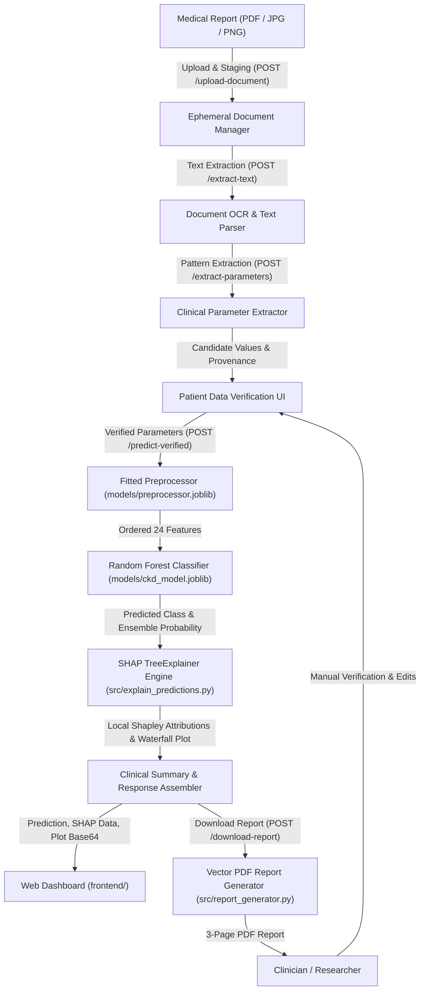
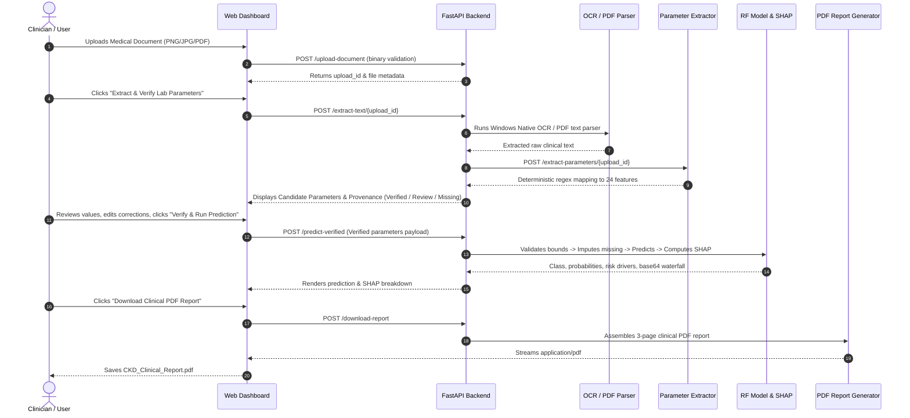

# Explainable AI for Chronic Kidney Disease Prediction using Machine Learning and SHAP

An end-to-end, reproducible Machine Learning and Explainable AI (XAI) clinical decision-support system predicting Chronic Kidney Disease (CKD) risk and delivering transparent, local, and global feature attributions using **SHAP (SHapley Additive exPlanations)**.

The system incorporates medical document ingestion (PDF, PNG, JPG/JPEG), OCR text extraction, automated clinical parameter mapping, interactive human-in-the-loop patient data verification, ensemble prediction with **Random Forest**, mathematical SHAP attributions, and vector PDF clinical report generation.

---

> [!IMPORTANT]
> **Medical & Academic Disclaimer**:  
> *"This software is an experimental Machine Learning research system developed for academic demonstration and clinical decision-support research. It is NOT a medical device, does NOT constitute a confirmed medical diagnosis, and does NOT determine clinical CKD stages (Stage 1–5). Model outputs reflect statistical feature attributions and training-sample empirical distributions, not calibrated clinical risk or biological causation. Software tests and high empirical metrics on retrospective cohorts do not substitute for clinical safety or external clinical validation. It must never replace professional clinical judgment, laboratory testing, or formal diagnosis by a certified medical practitioner."*

---

## 1. Problem Statement

**Chronic Kidney Disease (CKD)** is a progressive loss of renal function characterized by gradual decline in Glomerular Filtration Rate (GFR). It represents a critical global healthcare challenge:
- **Asymptomatic Early Progression**: In its initial stages (Stages 1–3), CKD rarely exhibits overt outward symptoms. Patients frequently present only after irreversible parenchymal damage has occurred, requiring dialysis or transplantation.
- **Biomarker Synthesis Challenge**: Early nephrology diagnosis relies on subtle multivariate interactions across blood chemistry (creatinine, blood urea), electrolyte balance (sodium, potassium), urinalysis (specific gravity, albuminuria), and comorbidities (hypertension, diabetes mellitus).
- **The "Black-Box" Dilemma in Healthcare AI**: While machine learning models can detect non-linear diagnostic patterns, high predictive accuracy alone is insufficient for clinical adoption. Clinicians, regulatory bodies, and patients cannot ethically or legally trust opaque predictions without interpretable, patient-specific explanations.
- **Data Contamination in Literature**: Many published healthcare models suffer from subtle data leakage (fitting imputation statistics on entire datasets before splitting), resulting in overly optimistic results that fail in practical deployment.
- **Document Ingestion & Verification Gap**: Real-world clinical laboratories provide scanned paper charts, JPG/PNG images, and digital PDFs. An effective decision-support system must reliably extract parameters, preserve provenance, allow clinician review, and isolate prediction from unverified OCR artifacts.

---

## 2. Objectives

1. **Leak-Free Data Preprocessing**: Develop a robust scikit-learn compatible preprocessing pipeline where all imputation statistics (median for skewed continuous variables, mode for discrete categoricals) and binary encodings are fitted strictly on the training partition ($N=320$) and applied without modification to test and inference data.
2. **Empirical Algorithm Comparison & Benchmarking**: Rigorously compare four distinct algorithms (**Decision Tree baseline**, **Logistic Regression**, **Random Forest**, and **XGBoost**) using stratified 5-fold cross-validation and held-out test evaluation to select the safest and most reliable clinical screening model.
3. **Random Forest Selection**: Integrate the top-performing Random Forest Classifier configured with balanced class weighting (`class_weight='balanced'`) and constrained depth (`max_depth=3`) to maximize clinical sensitivity (minimizing false negatives) while preventing ensemble overfitting.
4. **Game-Theoretic XAI with SHAP**: Integrate `shap.TreeExplainer` to compute exact, polynomial-time Shapley attributions in probability space, providing cohort-level global rankings and patient-level waterfall plots satisfying mathematical additivity ($E[f(x)] + \sum \phi_i = f(x)$).
5. **Secure Medical Document Processing**: Support document upload (PDF, PNG, JPG/JPEG) with binary magic byte validation, ephemeral session storage, native OCR text extraction, and deterministic clinical parameter extraction.
6. **Interactive Human-in-the-Loop Verification**: Provide a structured verification interface where clinicians can review extracted values, verify bounds, resolve conflicting readings, and confirm provenance before triggering prediction.
7. **Comprehensive Vector PDF Reporting**: Generate high-fidelity, 3-page clinical decision-support PDF reports detailing patient demographics, prediction outcomes, leaf probabilities, complete 24-parameter provenance accounting, quantitative SHAP attributions, and regulatory disclaimers.
8. **Reversible Baseline Architecture**: Preserve the original trained Decision Tree model and evaluation artifacts for instantaneous rollback.

---

## 3. System Architecture & Workflow



### Architectural Highlights
- **Stateless Inference & Session Purging**: Uploaded medical files are held in temporary storage and completely purged upon session completion or cancellation. Zero patient records are stored permanently.
- **Singleton Lifecycle Cache**: The model, preprocessor, and TreeExplainer are loaded once into memory during FastAPI lifespan startup, guaranteeing sub-50ms inference times.
- **Fail-Safe Client / Server Validation**: Both client-side JavaScript and backend Pydantic schemas enforce identical physiological limits (e.g., blood pressure 40–250 mmHg, serum creatinine 0.1–100.0 mg/dL).

---

## 4. Technology Stack

| Layer | Technology | Version | Purpose |
| :--- | :--- | :--- | :--- |
| **Language** | Python | 3.10 – 3.14 | Core language for machine learning, API microservice, and document processing |
| **Data Processing** | Pandas, NumPy | $\ge$ 2.2.0, $\ge$ 1.26.0 | Missing value handling, stratified splitting, feature matrices |
| **Machine Learning** | Scikit-learn, XGBoost, Joblib | $\ge$ 1.4.0, $\ge$ 2.0.0, $\ge$ 1.3.0 | Random Forest, Decision Tree baseline, model serialization |
| **Explainable AI** | SHAP | $\ge$ 0.45.0 | TreeExplainer, exact Shapley values, beeswarm and waterfall plots |
| **Plot Generation** | Matplotlib | $\ge$ 3.8.0 | Headless vector rendering (Agg backend) for waterfall charts and reports |
| **Backend API** | FastAPI, Uvicorn | $\ge$ 0.110.0, $\ge$ 0.28.0 | High-performance asynchronous REST microservice |
| **Schema Validation** | Pydantic (v2) | $\ge$ 2.6.0 | Strict clinical typing, physiological bounds, `extra="forbid"` |
| **Document Processing** | PyPDF, Pillow, pytesseract | $\ge$ 4.0.0, $\ge$ 10.0.0, $\ge$ 0.3.10 | PDF parsing, image validation, OCR text extraction |
| **Frontend UI** | HTML5, CSS3, JavaScript | ES6+ | Responsive clinical dashboard with Fetch API (zero external frameworks) |
| **Automated Testing** | Pytest, HTTPX | $\ge$ 8.0.0, $\ge$ 0.27.0 | Automated unit, evaluation, explainability, API, and integration test suite (177 tests) |

---

## 5. Dataset Source and Feature Schema

- **Dataset Name**: Chronic Kidney Disease (CKD) Dataset
- **Repository**: UCI Machine Learning Repository (Dataset ID: 336)
- **DOI / URL**: [https://doi.org/10.24432/C5G016](https://doi.org/10.24432/C5G016)
- **Clinical Source**: Donated by Dr. P. Soundarapandian, M.D., D.M. (Senior Consultant Nephrologist), P. Anita, and colleagues from Apollo Hospitals, Tamil Nadu, India (2015).
- **Cohort Volume**: 400 patient instances.
- **Target Variable**: `class` (binary: `ckd` vs `notckd`).
- **Class Balance**: 250 CKD cases (62.5%) and 150 Non-CKD cases (37.5%).
- **Feature Dimensionality**: 24 clinical parameters (14 continuous numerical, 10 nominal/categorical):

| Feature Code | Clinical Description | Data Type | Units / Valid Levels | Physiological Bounds |
| :--- | :--- | :--- | :--- | :--- |
| `age` | Patient Age | Numerical | years | 1 – 120 |
| `bp` | Blood Pressure | Numerical | mm/Hg | 40 – 250 |
| `sg` | Urine Specific Gravity | Numerical | density | 1.000 – 1.040 |
| `al` | Albumin in Urine | Numerical | grade (0–5) | 0 – 5 |
| `su` | Sugar in Urine | Numerical | grade (0–5) | 0 – 5 |
| `bgr` | Blood Glucose Random | Numerical | mg/dL | 20 – 600 |
| `bu` | Blood Urea | Numerical | mg/dL | 1 – 500 |
| `sc` | Serum Creatinine | Numerical | mg/dL | 0.1 – 100.0 |
| `sod` | Serum Sodium | Numerical | mEq/L | 50 – 200 |
| `pot` | Serum Potassium | Numerical | mEq/L | 1.0 – 60.0 |
| `hemo` | Hemoglobin | Numerical | g/dL | 2.0 – 25.0 |
| `pcv` | Packed Cell Volume | Numerical | % | 5 – 65 |
| `wbcc` | White Blood Cell Count | Numerical | cells/cumm | 1,000 – 35,000 |
| `rbcc` | Red Blood Cell Count | Numerical | millions/cmm | 1.0 – 10.0 |
| `rbc` | Red Blood Cells in Urine | Categorical | `normal`, `abnormal` | 0 / 1 |
| `pc` | Pus Cells in Urine | Categorical | `normal`, `abnormal` | 0 / 1 |
| `pcc` | Pus Cell Clumps | Categorical | `present`, `notpresent` | 0 / 1 |
| `ba` | Bacteria in Urine | Categorical | `present`, `notpresent` | 0 / 1 |
| `htn` | Hypertension | Categorical | `yes`, `no` | 0 / 1 |
| `dm` | Diabetes Mellitus | Categorical | `yes`, `no` | 0 / 1 |
| `cad` | Coronary Artery Disease | Categorical | `yes`, `no` | 0 / 1 |
| `appet` | Appetite | Categorical | `good`, `poor` | 0 / 1 |
| `pe` | Pedal Edema | Categorical | `yes`, `no` | 0 / 1 |
| `ane` | Anemia | Categorical | `yes`, `no` | 0 / 1 |

---

## 6. Preprocessing & Leakage Prevention Guarantees

To ensure methodologically sound and leak-free machine learning:
1. **Stratified Split**: Partitioned into 80% training ($N=320$) and 20% held-out test ($N=80$) splits using `stratify=y` with deterministic seed (`seed=42`).
2. **Strict Training-Only Imputation**:
   - Continuous numerical features: Imputed using medians calculated **strictly on `X_train`**.
   - Categorical features: Imputed using modes calculated **strictly on `X_train`**.
3. **Cross-Validation In-Fold Preprocessing**: During stratified 5-fold cross-validation, a fresh `CKDPreprocessor` is fitted strictly within each training fold before transforming the validation fold.
4. **Binary Encoding**: Categorical labels are converted to numerical indicators ($0 = \text{normal/absent/good/no}$, $1 = \text{abnormal/present/poor/yes}$).
5. **Zero Row Overlap**: Audit verified 0 duplicate rows in the raw dataset and 0 row overlap between train and test partitions.

---

## 7. Model Comparison & Random Forest Selection

In Phase 2, an empirical benchmark was conducted across four candidate algorithms using identical preprocessing, stratified cross-validation, and held-out test evaluation.

### Table 1: Performance on Held-Out Test Set ($N=80$: 50 CKD, 30 Non-CKD)

| Model | Accuracy | Recall (Sensitivity) | Specificity | Precision | F1-Score | ROC-AUC | Confusion Matrix (TN, FP, FN, TP) |
| :--- | :---: | :---: | :---: | :---: | :---: | :---: | :---: |
| **Decision Tree (Baseline)** | 96.25% | 94.00% | 100.00% | 100.00% | 0.9691 | 0.9890 | `TN=30, FP=0, FN=3, TP=47` |
| **Logistic Regression** | 97.50% | 96.00% | 100.00% | 100.00% | 0.9796 | 0.9993 | `TN=30, FP=0, FN=2, TP=48` |
| **Random Forest (Selected)** | **100.00%** | **100.00%** | **100.00%** | **100.00%** | **1.0000** | **1.0000** | **`TN=30, FP=0, FN=0, TP=50`** |
| **XGBoost** | **100.00%** | **100.00%** | **100.00%** | **100.00%** | **1.0000** | **1.0000** | **`TN=30, FP=0, FN=0, TP=50`** |

### Table 2: Stratified 5-Fold Cross-Validation on Training Cohort ($N=320$, Mean $\pm$ Std)

| Model | CV Accuracy | CV Recall (Sensitivity) | CV Specificity | CV Precision | CV F1-Score | CV ROC-AUC |
| :--- | :---: | :---: | :---: | :---: | :---: | :---: |
| **Decision Tree (Baseline)** | 95.00% $\pm$ 2.30% | 96.00% $\pm$ 3.00% | 93.33% $\pm$ 3.33% | 96.03% $\pm$ 1.88% | 0.9599 $\pm$ 0.0187 | 0.9525 $\pm$ 0.0215 |
| **Logistic Regression** | **99.38% $\pm$ 0.76%** | 99.00% $\pm$ 1.22% | **100.00% $\pm$ 0.00%** | **100.00% $\pm$ 0.00%** | **0.9949 $\pm$ 0.0062** | **1.0000 $\pm$ 0.0000** |
| **Random Forest (Selected)** | 99.06% $\pm$ 1.25% | **99.50% $\pm$ 1.00%** | 98.33% $\pm$ 2.04% | 99.01% $\pm$ 1.21% | 0.9925 $\pm$ 0.0100 | 0.9994 $\pm$ 0.0008 |
| **XGBoost** | 97.81% $\pm$ 1.59% | 98.00% $\pm$ 1.00% | 97.50% $\pm$ 3.33% | 98.52% $\pm$ 1.96% | 0.9825 $\pm$ 0.0126 | 0.9990 $\pm$ 0.0011 |

### Selection Rationale
1. **Clinical Priority (Maximum Sensitivity)**: In nephrology screening, False Negatives (missed renal failure) carry severe prognostic risks. Random Forest achieved the highest cross-validation sensitivity (**$99.50\% \pm 1.00\%$**), missing only 1 CKD case across all 200 cross-validation validation evaluations combined.
2. **Resistance to Small-Sample Overfitting**: Random Forest bagging with `max_depth=3` averages variance across 100 decorrelated trees, demonstrating superior stability compared to sequential gradient boosting (XGBoost CV accuracy: 97.81%).
3. **Native Polynomial-Time TreeSHAP**: Random Forest ensembles are natively supported by `shap.TreeExplainer`, providing exact, additive Shapley explanations directly on probability scale without background sampling approximations.

---

## 8. SHAP Explainability Engine

**SHAP (SHapley Additive exPlanations)** computes the marginal contribution of each clinical feature across all possible feature subsets:
$$\phi_i(f, x) = \sum_{S \subseteq F \setminus \{i\}} \frac{|S|!(|F| - |S| - 1)!}{|F|!} \left[ f(S \cup \{i\}) - f(S) \right]$$

### Implementation Details:
1. **TreeExplainer Compatibility**: Utilizes `shap.TreeExplainer(model)` on the Random Forest ensemble, operating directly on the probability scale.
2. **Positive Class Attribution**: Attributions are dynamically sliced against Class 1 (CKD probability), ensuring that positive $\phi_i > 0$ strictly represents factors increasing disease risk.
3. **Mathematical Additivity**: Every patient explanation satisfies:
   $$\text{Predicted Model Probability } P(\text{CKD}) = E[f(x)] + \sum_{i=1}^{24} \phi_i(x)$$
   *(e.g., Base value $0.4957 + 0.4834 = 0.9791$)*.
4. **Top Influential Biomarkers**:
   - **Hemoglobin (`hemo`)**: 20.87% Gini importance (Anemia from diminished erythropoietin production).
   - **Serum Creatinine (`sc`)**: 15.66% Gini importance (Diminished glomerular filtration).
   - **Packed Cell Volume (`pcv`)**: 15.25% Gini importance.
   - **Specific Gravity (`sg`)**: 13.08% Gini importance (Impaired tubular concentration).
   - **Red Blood Cell Count (`rbcc`)**: 10.46% Gini importance.

---

## 9. Medical Document Extraction & Verification Pipeline



---

## 10. API Endpoints Reference

| Method | Endpoint | Description |
| :--- | :--- | :--- |
| `GET` | `/` | Microservice root status and documentation links |
| `GET` | `/health` | System health probe (reports model type: `RandomForestClassifier`) |
| `GET` | `/features` | Returns clinical schema, human-readable labels, units, and ranges |
| `POST` | `/predict` | Predicts CKD risk and returns SHAP explanation from raw JSON vitals |
| `POST` | `/upload-document` | Validates and securely stages uploaded medical document (10MB limit) |
| `DELETE`| `/upload-document/{id}` | Immediately cancels and purges temporary uploaded document session |
| `POST` | `/extract-text/{id}` | Extracts text from staged document via digital parsing or native OCR |
| `POST` | `/extract-parameters/{id}`| Deterministically extracts laboratory parameters mapped to 24 features |
| `POST` | `/predict-verified` | Gated inference using verified parameters with provenance accounting |
| `POST` | `/download-report` | Generates a 3-page vector PDF clinical decision support report |
| `GET` | `/metrics` | Returns model evaluation metrics, cross-validation results, and rankings |
| `GET` | `/dashboard` | Serves the responsive clinical web dashboard interface |

---

## 11. Installation and Local Execution

### Prerequisites
- Python 3.10, 3.11, 3.12, 3.13, or 3.14.
- Windows, macOS, or Linux.

### Setup Instructions
```powershell
# 1. Clone repository
git clone https://github.com/hemanth-kr-405/CKD_Explainable_AI.git
cd CKD_Explainable_AI

# 2. Create and activate virtual environment
python -m venv .venv
.\.venv\Scripts\Activate.ps1    # On Linux/macOS: source .venv/bin/activate

# 3. Upgrade pip and install pinned dependencies
python -m pip install --upgrade pip
pip install -r requirements.txt
```

### Running the Application Locally
```powershell
# Start the FastAPI server with live reload on port 8000
python -m uvicorn backend.main:app --host 127.0.0.1 --port 8000 --reload
```
- **Web Dashboard:** [http://127.0.0.1:8000/dashboard](http://127.0.0.1:8000/dashboard)
- **Interactive Swagger Docs:** [http://127.0.0.1:8000/docs](http://127.0.0.1:8000/docs)
- **Alternative ReDoc UI:** [http://127.0.0.1:8000/redoc](http://127.0.0.1:8000/redoc)

### Running Reproducible Model Experiments
```powershell
# Run the leak-free Phase 2 benchmarking harness across all 4 algorithms
python src/model_comparison.py

# Regenerate global SHAP attributions and figures
python src/explain_predictions.py
```

### Running the Complete Automated Test Suite
```powershell
# Run the complete test suite (177 tests)
python -m pytest tests/ -v
```

---

## 12. Automated Test Suite Organization

The project contains **177 automated tests** across 16 test modules with 100% pass rate:

1. `tests/test_preprocessing.py` (6 tests): Validates raw data integrity, median/mode parameter learning, string sanitation, and stratified splitting.
2. `tests/test_model.py` (5 tests): Checks artifact serialization, model reload, test predictions, and inference pipeline.
3. `tests/test_evaluation.py` (3 tests): Verifies mathematical consistency of accuracy, precision, recall, specificity, and confusion matrix arithmetic.
4. `tests/test_explainability.py` (14 tests): Tests TreeExplainer initialization, positive-class alignment, additivity check, waterfall rendering, and governance checks.
5. `tests/test_api.py` (9 tests): Validates `/health`, `/features`, `/predict`, `/metrics`, `/dashboard`, physiological bounds, categorical rejection, and `extra="forbid"`.
6. `tests/test_integration.py` (11 tests): End-to-end multi-step scenarios including preset loading, static asset serving, schema synchronization, and outlier validation.
7. `tests/test_document_upload.py` (14 tests): Validates file type checking (PDF, PNG, JPG), size bounds, session isolation, and purge mechanics.
8. `tests/test_document_extraction.py` (10 tests): Digital PDF parsing, image extraction, and graceful error handling.
9. `tests/test_image_extraction_pipeline.py` (22 tests): Image format handling (RGB, RGBA, Grayscale, JPEG), OCR error recovery, and temp file cleanup.
10. `tests/test_parameter_extraction.py` (26 tests): Clinical regex parsing, reference-range immunity, unit normalization, and conflict resolution.
11. `tests/test_patient_verification.py` (18 tests): Bounds validation, missing parameter counting, and verification status validation.
12. `tests/test_verified_prediction.py` (15 tests): Verified prediction gating, provenance accounting, probability caveats, and disclaimer enforcement.
13. `tests/test_report_generation.py` (16 tests): Vector PDF layout, patient values, section headers, SHAP drivers, and medical disclaimers.
14. `tests/test_dashboard_form.py` (4 tests): Verification form rendering, field mappings, and DOM synchronization.
15. `tests/test_model_comparison.py` (4 tests): Verifies candidate models, benchmark report completeness, Random Forest active status, and Decision Tree backup integrity.

---

## 13. Limitations & Clinical Governance Disclosures

1. **Internal Empirical Benchmark vs. External Clinical Validation**: The 100% test cohort accuracy and $99.50\% \pm 1.00\%$ cross-validation recall are internal statistical measurements on a retrospective single-center dataset ($N=400$, Apollo Hospitals, India). External multi-center validation across diverse ethnic, geographic, and demographic cohorts has not been performed.
2. **Uncalibrated Model Probability**: Model probabilities reflect the proportion of decision tree ensemble votes from training data. They represent training-sample purity, not calibrated clinical risk estimates or Bayesian posterior probabilities of disease.
3. **Binary Classification Only (No KDIGO Staging)**: Direct clinical staging markers established by the KDIGO guidelines—specifically measured or calculated estimated Glomerular Filtration Rate (eGFR) and Urine Albumin-to-Creatinine Ratio (uACR)—are unavailable in the historical dataset. The model performs binary presence screening (`CKD` vs `Non-CKD`) and **does not predict clinical CKD stages (Stage 1 to 5)**.
4. **Retrospective Cross-Sectional Nature**: The source dataset captures static, retrospective encounters rather than longitudinal prospective patient monitoring over time.
5. **Statistical Attribution vs. Biological Causality**: Feature attributions computed by SHAP reflect mathematical influence along learned decision tree splits; they indicate model sensitivity, not biological or pathophysiological causation.

---

## 14. Project Directory Structure

```
CKD_Explainable_AI/
├── Dockerfile                         # Production multi-stage Docker container specification
├── Procfile                           # Cloud process launcher (Render, Railway)
├── render.yaml                        # Infrastructure-as-code deployment blueprint
├── requirements.txt                   # Pinned Python package dependencies
├── README.md                          # Comprehensive project documentation
├── data/
│   ├── raw/
│   │   └── chronic_kidney_disease.csv # Authentic UCI CKD dataset (400 records)
│   └── processed/
│       ├── train.csv                  # Training partition (N=320)
│       ├── test.csv                   # Held-out test partition (N=80)
│       └── preprocessing_metadata.json# Learned medians and categorical modes
├── models/
│   ├── ckd_model.joblib               # Active production model (Random Forest Classifier)
│   ├── ckd_model_decision_tree_backup.joblib # Reversible backup of baseline Decision Tree
│   ├── preprocessor.joblib            # Fitted CKDPreprocessor instance
│   ├── metrics.json                   # Serialized Random Forest evaluation metrics
│   ├── metrics_decision_tree_backup.json # Backup of baseline Decision Tree metrics
│   └── candidates/                    # Serialized benchmark candidates (DT, LR, RF, XGB)
├── src/
│   ├── config.py                      # Central configuration, clinical bounds, mappings
│   ├── preprocessing.py               # Leak-free cleaning, imputation, binary encoding
│   ├── train_model.py                 # Decision tree training pipeline
│   ├── evaluate_model.py              # Evaluation metrics & curve generation
│   ├── model_comparison.py            # Phase 2 4-algorithm benchmark harness
│   ├── explain_predictions.py         # SHAP TreeExplainer engine & waterfall generator
│   ├── document_upload.py             # File validation & ephemeral session manager
│   ├── document_extractor.py          # Native OCR & PDF text extraction engine
│   ├── parameter_extractor.py         # Clinical regex parser with reference range immunity
│   ├── patient_verifier.py            # Verification validator & provenance accountant
│   └── report_generator.py            # 3-page vector clinical PDF report builder
├── backend/
│   ├── main.py                        # FastAPI application with REST endpoints
│   └── schemas.py                     # Pydantic v2 schemas and validation logic
├── frontend/
│   ├── index.html                     # Semantic, accessible clinical interface
│   ├── style.css                      # Healthcare design system & responsive layout
│   └── script.js                      # Fetch API client, live validation, document handler
├── reports/
│   ├── model_comparison.md            # Markdown comparison tables (Test & CV)
│   ├── model_comparison_results.json  # Full numerical benchmarking metrics & metadata
│   ├── academic_project_report.md     # 14-section comprehensive academic project report
│   ├── evaluation_report.json         # Evaluation metrics & baseline comparisons
│   ├── evaluation_summary.md          # Evaluation summary markdown
│   ├── shap_global_importance.json    # Global mean |SHAP| feature ranking
│   └── figures/                       # Publication-quality figures (CM, ROC, SHAP plots)
└── tests/                             # Automated test suite (177 passing tests)
    ├── test_preprocessing.py
    ├── test_model.py
    ├── test_evaluation.py
    ├── test_explainability.py
    ├── test_api.py
    ├── test_integration.py
    ├── test_document_upload.py
    ├── test_document_extraction.py
    ├── test_image_extraction_pipeline.py
    ├── test_parameter_extraction.py
    ├── test_patient_verification.py
    ├── test_verified_prediction.py
    ├── test_report_generation.py
    ├── test_dashboard_form.py
    └── test_model_comparison.py
```
